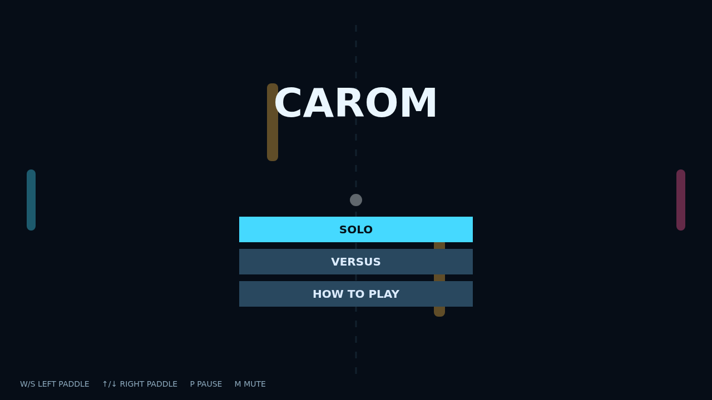

# Carom

Carom starts as a clean rally across a midnight table, then quickly becomes a game of angles. Guide your colored paddle through the opening serve and look for the lane past the glowing center bars.

The real trick is motion: slide into a hit to add spin, turning a simple return into a curling shot that drifts away from a waiting opponent. The trail makes every bend legible at a glance.

Banking around the amber obstacles turns each exchange into a small puzzle. Whether you are outfoxing the Solo AI or sharing a keyboard in Versus, a two point lead at match point always feels earned.

